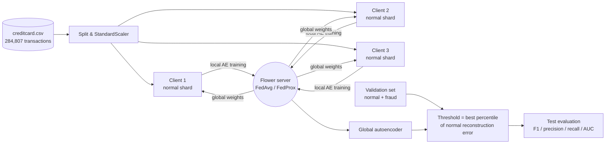
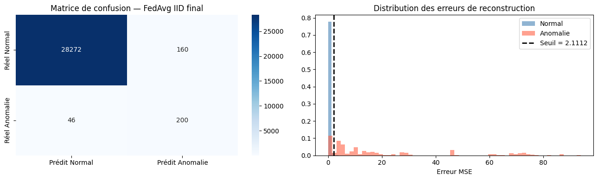
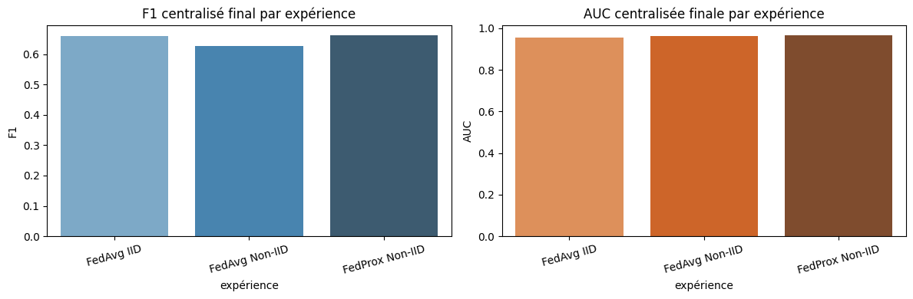
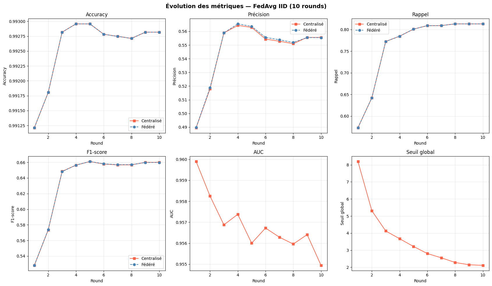

<div align="center">

# 🛡️ Federated Autoencoder for Credit-Card Fraud Detection

**Unsupervised anomaly detection trained with federated learning (Flower) — raw transactions never leave the clients.**


</div>

---

## 📌 Overview

This project trains a **deep autoencoder** to detect fraudulent card transactions **without using fraud labels for training**. The model learns to reconstruct *normal* transactions; transactions with a high reconstruction error are flagged as anomalies.

Training is **federated**: three simulated clients each keep a private shard of the normal transactions, train locally, and only share model weights with a server that aggregates them (**FedAvg**, plus **FedProx** for heterogeneous data). Everything is implemented in a single notebook, [`Federated_Autoencoder(nour ghribi).ipynb`](./Federated_Autoencoder%28nour%20ghribi%29.ipynb), using the Flower simulation engine.

> **Scope.** This is a *simulation* on a public benchmark (clients are virtual and run on one machine). It is a research prototype, not a production fraud system.

## 🎯 Objectives

- Detect fraud as an **anomaly-detection** problem (train on normal data only).
- Compare **FedAvg** and **FedProx** under **IID** and **non-IID** client partitions.
- Select the anomaly threshold on a **validation set** instead of fixing it by hand.

## 🧭 Architecture & Workflow



**Federated round (10 rounds, 1 local epoch each):** the server sends the global weights → each client trains on its local normal data → the server aggregates the updates → the global model is evaluated on the server test set and on each client's local test data.

## 🧠 Model

A symmetric autoencoder (**10,374 parameters**) with batch normalisation, ELU activations, dropout (0.1) and L2 regularisation (1e-4):

```text
Input(30) → 64 → 32 → 16 → [latent 8] → 16 → 32 → 64 → Output(30)
```

| Setting | Value |
|---|---|
| Loss / optimiser | MSE / Adam (lr = 1e-3) |
| Clients / rounds | 3 clients, 10 rounds |
| Local training | 1 epoch per round, batch size 256 |
| Strategies | `FedAvg`, `FedProx` (`proximal_mu = 0.01`, provided by Flower) |
| Anomaly score | per-sample MSE reconstruction error |
| Threshold | percentile of normal validation errors, chosen among `[95, 97, 98, 99, 99.5, 99.9]` by validation F1 (99.5 selected in the final round of all three experiments) |

## 🗂️ Dataset

[Credit Card Fraud Detection (ULB / Kaggle)](https://www.kaggle.com/datasets/mlg-ulb/creditcardfraud) — 284,807 transactions, 492 frauds (0.17 %), 30 numeric features (`Time`, `V1`–`V28` PCA components, `Amount`).

| Split | Normal | Fraud | Used for |
|---|---:|---:|---|
| Train (clients) | 227,452 | – | autoencoder training (normal only) |
| Validation | 28,431 | 246 | threshold selection |
| Test | 28,432 | 246 | final evaluation |

`creditcard.csv` is **not** versioned (size limit) — download it from Kaggle and place it next to the notebook.

**Partitions.** *IID*: random equal shards. *Non-IID*: transactions sorted by `Amount` and cut into 3 contiguous shards, so each client sees a different amount profile.

## 📊 Results

All numbers below come from the executed notebook (10 rounds, 3 clients, final round, server test set of 28,678 transactions).

| Experiment | Validation F1 | Federated F1 | Centralised-eval F1 | AUC |
|---|---:|---:|---:|---:|
| FedAvg · IID | 0.6655 | 0.6599 | **0.6601** | 0.9549 |
| FedAvg · non-IID | 0.6107 | 0.6577 | 0.6257 | 0.9626 |
| FedProx · non-IID | 0.6230 | 0.7052 | **0.6620** | 0.9666 |

*"Federated F1"* is the sample-weighted average over the clients' local test sets; *"Centralised-eval F1"* evaluates the global model on the full server test set.

**FedAvg · IID, final round (server test set):** accuracy 0.9928, precision 0.5554, recall 0.8130 — i.e. **200 of 246 frauds detected, with 160 false alarms among 28,432 normal transactions.**

<p align="center">
  
</p>
<p align="center">
  
</p>
<p align="center">
  
</p>

**Reading the results honestly**

- The model separates the classes well (AUC ≈ 0.95–0.97) but precision is moderate (~0.55) at the validation-selected threshold: this is a trade-off between recall and false alarms.
- On non-IID data FedProx gives the best centralised-eval F1 and AUC, but differences between experiments are small and come from **a single run per configuration** (no seeds/confidence intervals yet), so they should not be over-interpreted.
- No centralised (non-federated) baseline is included in the notebook.

## ✅ Verification Status

The numbers above were **read from the executed notebook outputs** (a run dated 2026-04-23); the notebook was **not re-run** here because it needs the Kaggle dataset, TensorFlow, Flower and Ray (≈ 6 minutes on 12 CPU threads). Treat the results as single-run values.

## 🧰 Tech Stack

| Role | Tools |
|---|---|
| Deep learning | TensorFlow / Keras |
| Federated learning | Flower (`flwr`) simulation, Ray virtual client engine |
| Data & metrics | pandas, NumPy, scikit-learn |
| Visualisation | matplotlib, seaborn |

## 🚀 Reproduce

```bash
# 1. Environment (the notebook was run with Python 3.10)
pip install tensorflow "flwr[simulation]" ray pandas numpy scikit-learn matplotlib seaborn

# 2. Data: download creditcard.csv from Kaggle into this folder

# 3. Run
jupyter notebook "Federated_Autoencoder(nour ghribi).ipynb"
```

The full 10-round FedAvg run took ≈ 380 s on the author's machine (12 CPU threads).

> ⚠️ The notebook uses `flwr.simulation.start_simulation`, which newer Flower versions flag as deprecated (migration to `flwr run` is future work). Pin the `flwr` version you test with.

## 🔭 Limitations & Future Work

- Single dataset, single run per setting; add multiple seeds and confidence intervals.
- Add a centralised-training baseline to quantify the cost of federation.
- Non-IID is simulated by sorting on `Amount`; try Dirichlet label/feature skew and more clients.
- No differential privacy or secure aggregation (only the "data stays local" property of FL).
- Migrate to the current Flower app API; extract notebook code into a reusable module.

## 👤 Author

**Nour Ghribi** — AI & Data Science Engineering student, FST (University of Tunis El Manar)  
[GitHub](https://github.com/Nour-Ghribi)

## 📚 References

- McMahan et al., *Communication-Efficient Learning of Deep Networks from Decentralized Data* (FedAvg), AISTATS 2017.
- Li et al., *Federated Optimization in Heterogeneous Networks* (FedProx), MLSys 2020.
- Beutel et al., *Flower: A Friendly Federated Learning Framework*, 2020.
- Dal Pozzolo et al., *Calibrating Probability with Undersampling for Unbalanced Classification*, IEEE SSCI 2015 (dataset).
